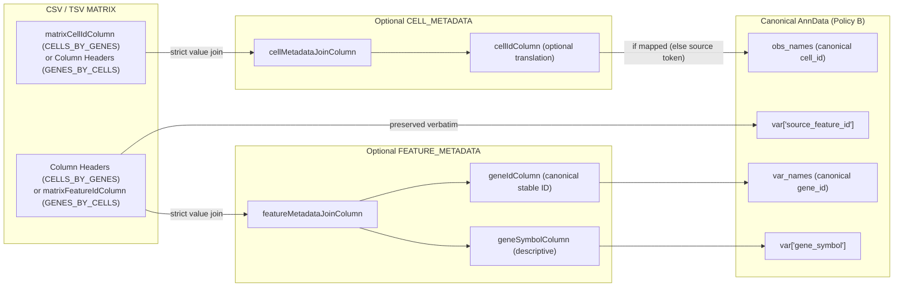
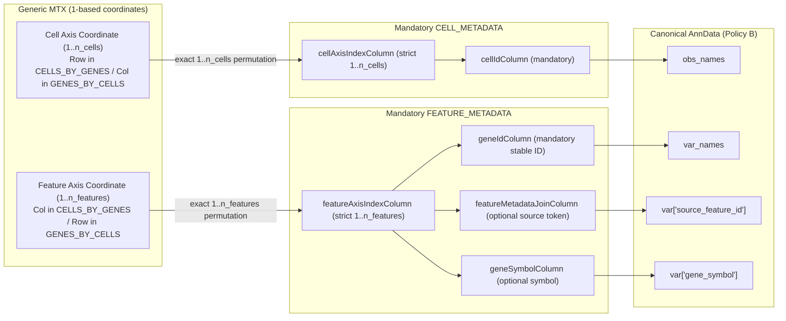

# CellWeave Phase 3 — Generic Matrix Importer Architecture & Specification

## 1. Scope & Authority
- **Authority**: `docs/architecture/CellWeave-Production-Master-System-Design-v1.0.pdf` (Section 121: Scientific Import System, Phase 3) and the Step G.1 Contract Amendment (`MetadataMappingSubmission`).
- **Supported Formats**:
  - `SourceFormat.GENERIC_MATRIX`: Delimited expression matrices (CSV / TSV, plain or bounded `.gz`) and Matrix Market coordinate files (`.mtx` / `.mtx.gz`).
- **Participating Roles & Cardinality**:
  - `ImportFileRole.MATRIX`: exactly 1 file (mandatory).
  - `ImportFileRole.CELL_METADATA`: 0..1 file (optional for CSV/TSV, mandatory for Generic MTX).
  - `ImportFileRole.FEATURE_METADATA`: 0..1 file (optional for CSV/TSV, mandatory for Generic MTX).
  - Extraneous roles (`PRIMARY`, `BARCODES`, `FEATURES`) are strictly prohibited (`INVALID_IMPORT_CARDINALITY`).
- **Canonical Representation**: CellWeave Canonical AnnData Policy B (raw unnormalized integer counts stored strictly in `X` as SciPy CSR; `layers` empty; `obsm`, `varm`, `obsp`, `varp` empty; minimal controlled provenance in `uns`).

---

## 2. Content-Based Format & Delimiter Detection
- **No Extension-Authoritative Decisions**: Parsing semantics and delimiter resolution are inferred strictly from stream contents, never from `.csv` or `.tsv` filename extensions.
- **Matrix Market**: Detected via leading magic bytes `%%MatrixMarket` in plain or bounded gzip chunks.
- **Delimiter Sniffing (`sniff_delimiter`)**:
  - Lines containing commas and 0 tabs resolve as comma-delimited (`,`).
  - Lines containing tabs and 0 commas resolve as tab-delimited (`\t`).
  - Mixed lines require a $\ge 2:1$ predominance ratio; otherwise, fails closed with `ScientificIssueCode.FORMAT_MISMATCH`.
  - Undelimited single-column files (0 commas and 0 tabs across lines) resolve deterministically to a single-column table independent of filename extension.
  - An expression matrix file must contain at least 2 columns; single-column matrices fail closed with `ScientificIssueCode.MALFORMED_INPUT`.
- **Bounded Decompression Safety**: All gzip reading streams through Step D `open_bounded_gzip_stream` governed by explicit `DecompressionLimits`.

---

## 3. Authoritative Identity Model & Orientation Policy (Step G.1 / G.2)

All pre-G.1 heuristics (column-0 identity fallback, named non-numeric first-column heuristic, Pandas `RangeIndex` fallback, metadata row-position assumptions, subset-overlap column guessing, and 10x barcode/feature positional conventions) are removed.

| Source Type | Source Cell Identity Authority | Source Feature Identity Authority | Metadata Join / Coordinate Authority | Canonical `obs_names` Authority | Canonical `var_names` Authority |
| :--- | :--- | :--- | :--- | :--- | :--- |
| **CSV/TSV `CELLS_BY_GENES`** | Explicit matrix column (`mapping.matrixCellIdColumn`, mandatory) | Raw expression column headers (all headers excluding `matrixCellIdColumn`) | Cell: `mapping.cellMetadataJoinColumn` (mandatory if `CELL_METADATA` supplied) Feature: `mapping.featureMetadataJoinColumn` (mandatory if `FEATURE_METADATA` supplied) | `CELL_METADATA[mapping.cellIdColumn]` if mapped, else validated source cell tokens from `MATRIX[matrixCellIdColumn]` | `FEATURE_METADATA[mapping.geneIdColumn]` if mapped, else validated source feature header tokens |
| **CSV/TSV `GENES_BY_CELLS`** | Raw expression column headers (all headers excluding `matrixFeatureIdColumn`) | Explicit matrix column (`mapping.matrixFeatureIdColumn`, mandatory) | Cell: `mapping.cellMetadataJoinColumn` (mandatory if `CELL_METADATA` supplied) Feature: `mapping.featureMetadataJoinColumn` (mandatory if `FEATURE_METADATA` supplied) | `CELL_METADATA[mapping.cellIdColumn]` if mapped, else validated source cell header tokens | `FEATURE_METADATA[mapping.geneIdColumn]` if mapped, else validated source feature tokens from `MATRIX[matrixFeatureIdColumn]` |
| **MTX `CELLS_BY_GENES`** | MTX row coordinate $1 \dots n_{\text{cells}}$ aligned via `CELL_METADATA[mapping.cellAxisIndexColumn]` | MTX column coordinate $1 \dots n_{\text{features}}$ aligned via `FEATURE_METADATA[mapping.featureAxisIndexColumn]` | Cell coordinate: `mapping.cellAxisIndexColumn` (mandatory) Feature coordinate: `mapping.featureAxisIndexColumn` (mandatory) Optional source tokens: `cellMetadataJoinColumn`, `featureMetadataJoinColumn` | `CELL_METADATA[mapping.cellIdColumn]` (mandatory; never the numeric axis index) | `FEATURE_METADATA[mapping.geneIdColumn]` (mandatory; never the numeric axis index) |
| **MTX `GENES_BY_CELLS`** | MTX column coordinate $1 \dots n_{\text{cells}}$ aligned via `CELL_METADATA[mapping.cellAxisIndexColumn]` | MTX row coordinate $1 \dots n_{\text{features}}$ aligned via `FEATURE_METADATA[mapping.featureAxisIndexColumn]` | Cell coordinate: `mapping.cellAxisIndexColumn` (mandatory) Feature coordinate: `mapping.featureAxisIndexColumn` (mandatory) Optional source tokens: `cellMetadataJoinColumn`, `featureMetadataJoinColumn` | `CELL_METADATA[mapping.cellIdColumn]` (mandatory; never the numeric axis index) | `FEATURE_METADATA[mapping.geneIdColumn]` (mandatory; never the numeric axis index) |

### Identity Flow Diagrams

#### A. CSV/TSV Token $\to$ Metadata Join $\to$ Canonical Identity

#### B. Generic MTX Coordinate Index $\to$ Metadata Row $\to$ Source Token $\to$ Canonical Identity

---

## 4. Generic MTX Coordinate Validation Invariants
For both `cellAxisIndexColumn` and `featureAxisIndexColumn`:
- Values must be strict 1-based positive integer strings (`^[1-9][0-9]*$`).
- Rejects zero (`0`), negative numbers, fractional values, non-numeric text, blanks/nulls, duplicates, gaps, out-of-range coordinates, or extra metadata rows.
- The set of cell coordinates must equal $\{1, 2, \dots, n_{\text{cells}}\}$ and the set of feature coordinates must equal $\{1, 2, \dots, n_{\text{features}}\}$.
- Metadata file row order is completely irrelevant: reordering `CELL_METADATA` or `FEATURE_METADATA` rows produces bit-for-bit identical canonical `obs_names`, `var_names`, `var["source_feature_id"]`, and `X` count coordinates.
- Helper coordinate columns (`cellAxisIndexColumn`, `featureAxisIndexColumn`) are used solely for alignment and are **never** copied into canonical `obs` or `var`.

---

## 5. Inspection Column Discovery & Current Contract Boundary
- `inspect()` returns `availableCellMetadataColumns` from `CELL_METADATA` and `availableFeatureMetadataColumns` from `FEATURE_METADATA`.
- **Documented Contract Limitation for UI Wizard**: `ImportInspectionResult` (`schemas/domain/import-inspection-result.v1.json`) intentionally exposes `availableCellMetadataColumns` and `availableFeatureMetadataColumns` for supplied metadata files and does not include a separate field for `MATRIX`-internal column headers. When the future UI Metadata Wizard prompts for `matrixCellIdColumn` or `matrixFeatureIdColumn` on a CSV/TSV `MATRIX`, it must either inspect the uploaded matrix header preview or enter the explicit matrix identifier column name without polluting `availableCellMetadataColumns` or `availableFeatureMetadataColumns`.

---

## 6. Sample Mapping & Biological Annotations
- **Zero Sample Pass-Through**: `sampleColumn` values must resolve 100% through `mapping.sampleMappings` (`SampleMappingEntry.sampleKey`). Missing or partial mappings fail closed (`MISSING_REQUIRED_METADATA`).
- **Optional `obs` Columns** (populated only when explicitly mapped):
  `["sample_key", "condition", "batch", "biological_replicate", "technical_replicate"]`.
- **Controlled `var` Columns**:
  `["source_feature_id"]` plus optional `"gene_symbol"` when `geneSymbolColumn` is explicitly mapped.
- **Controlled `uns` Keys**:
  `organism`, `gene_id_scheme`, and optional `reference_build` (only when explicitly provided).
